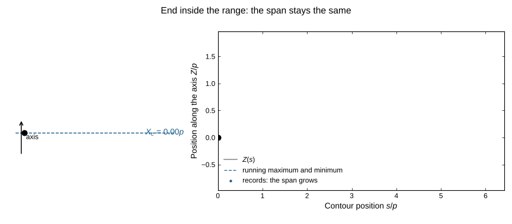
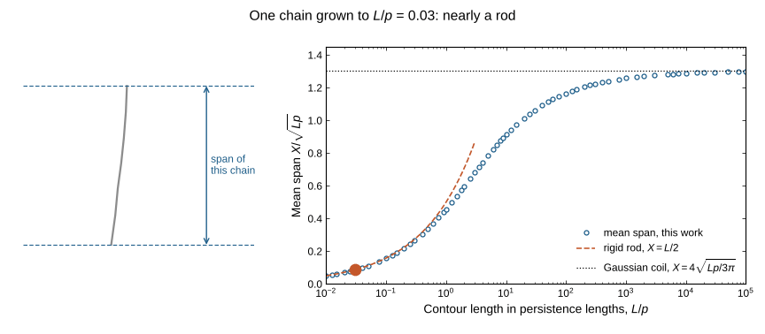
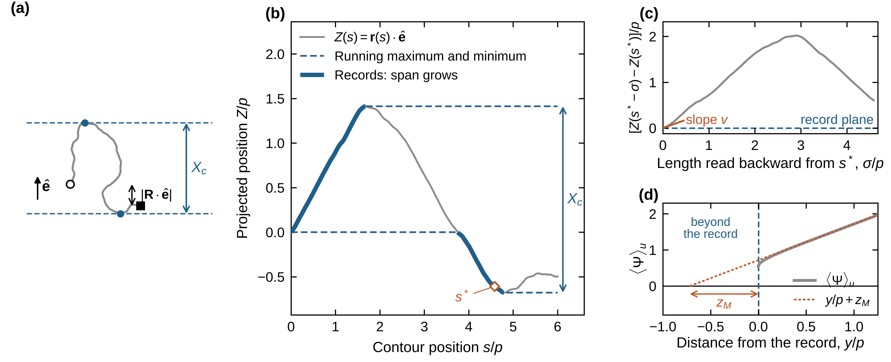
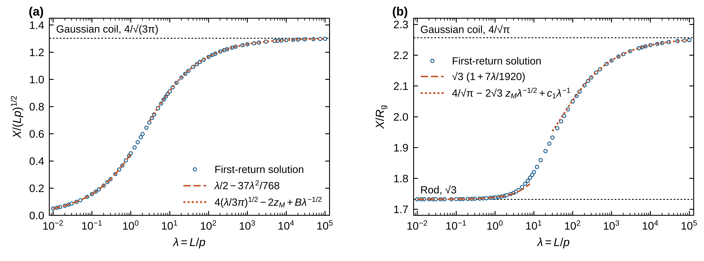
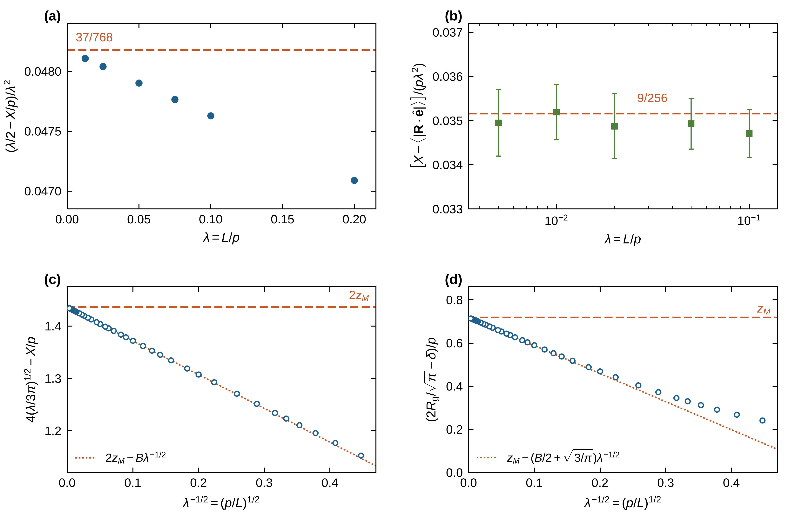

# Mean span dimension of an ideal wormlike chain

[](#citation)
[](LICENSE)
[](DATA_LICENSE.md)
[](requirements.txt)

Code, data, figures and a step-by-step tutorial for the article **"Mean span dimension of an ideal
wormlike chain"** by Yanwei Wang (Nazarbayev University), submitted to *The Journal of Chemical Physics*
in November 2026. The version described in the submitted article is release
[v1.2.0](https://github.com/ktwyw/wlc-mean-span/releases/tag/v1.2.0); later commits change only this
page and its illustrations.

## The question

The **span** of a polymer conformation along an axis is the distance between its two outermost points
along that axis; its average over conformations is the **mean span dimension** $X$. It measures how far a
chain reaches, and it sets how strongly a chain is depleted near a wall and how it partitions into pores.
For a flexible (Gaussian) chain, $X$ has been known in closed form since Daniels (1941). For the
**wormlike chain**, the standard model of stiff and semiflexible polymers such as DNA and actin, there was
no exact or controlled theory, because the position of a wormlike chain along an axis is not a Markov
process: where the chain goes next depends on where it points.

<p align="center">
  
</p>

The animation shows the starting point of the theory. The span of a conformation increases **only while
the chain end sets a new record** (a new highest or lowest point along the axis) and the end points
outward. Averaged over conformations and read backward along the contour, the growth rate of $X$ becomes a
first-passage question: starting on a plane and moving away from it, how likely is the chain not to have
come back to that plane within the given length?

## The answers

With $L$ the contour length and $p$ the persistence length:

1. **An exact identity.** The growth of the mean span with contour length is half a survival probability,

   $$\frac{dX}{dL}=\frac12\,\Pr\left(T>\frac{L}{p}\right),$$

   where $T$ is the length (in units of $p$) after which a chain started on a plane, with a speed drawn
   from the outgoing flux, first returns to that plane. It follows that $X$ is concave in $L$.

2. **Short chains.** The first correction to the rigid-rod value comes in closed form from the return law
   of the randomly accelerated particle:
   $$X=\frac{L}{2}-\frac{37}{768}\,\frac{L^2}{p}+\dots$$

3. **Long chains.** The Gaussian-coil law is shifted by twice the Milne extrapolation length $z_M=0.71821$
   of angular-diffusion transport (under a boundary-layer matching assumption stated in the article):
   $$X=4\sqrt{\frac{Lp}{3\pi}}-1.436\,p+0.647\,p\sqrt{\frac{p}{L}}+\dots$$
   The same rule holds exactly for the telegraph process and the planar run-and-tumble particle.

4. **The whole crossover.** A spectral solution covers $10^{-2}\le L/p\le 10^{5}$. It is checked by an
   independent finite-volume solution and by direct chain sampling up to $L/p=10^{4}$, and a compact
   formula reproduces it to 0.1%.

5. **Consequences for polymer physics.** The ratio of the span to the radius of gyration reaches its coil
   value $4/\sqrt\pi$ only as $(L/p)^{-1/2}$; it is still 1.5% below it at $L/p=5000$. Since the depletion
   thickness at a hard wall is half the mean span, the depletion layer of long chains is that of a
   Gaussian chain with the same radius of gyration, thinner by $0.718\,p$.

<p align="center">
  
</p>

The animation follows one chain as it grows from a rod to a coil. On the right, the marker runs along the
mean span computed in this work (circles), which leaves the rigid-rod line $X=L/2$ and approaches the
Gaussian-coil plateau slowly, because of the offset $-1.436\,p$. A single chain is shown for intuition; the
curve is an average over all conformations.

## The figures of the article

<p align="center">
  
</p>

**Fig. 1. The idea.** (a) A conformation and its span $X_c$. (b) Its position along the axis: the span grows
only on the record segments (thick). (c) Read backward from a record, the trace starts on the record plane
and must stay on one side of it. (d) For long chains, the solution near the record plane is the Milne
problem of transport theory, whose extrapolation length $z_M$ sets the offset.

<p align="center">
  
</p>

**Fig. 2. From rod to coil.** (a) The mean span over seven decades of $L/p$ (circles) with the short-chain
(dashed) and long-chain (dotted) expansions. (b) The ratio to the radius of gyration, which approaches its
coil value only slowly.

<p align="center">
  
</p>

**Fig. 3. The asymptotic results tested.** Each panel rearranges the numerical solution so that it should
approach one predicted constant: (a) $37/768$, (b) the endpoint excess $9/256$, (c) $2z_M$ and (d) the
wall offset $z_M$ of the depletion layer.

## For reviewers: where to check each result

Every result can be followed and recomputed in the executed notebooks of `tutorial/`, without running
anything. Each chapter gives the derivation step by step, with a symbolic (SymPy) or numerical check of
each step.

| Result | Tutorial notebook |
|---|---|
| The record picture, definitions of the span and the radius of gyration | [`01_model_and_span`](tutorial/01_model_and_span.ipynb) |
| The exact first-return identity, two derivations, tested on sampled chains | [`02_first_return_identity`](tutorial/02_first_return_identity.ipynb) |
| Span-to-gyration ratio; depletion identity and wall offset | [`03_radius_of_gyration`](tutorial/03_radius_of_gyration.ipynb) |
| Short chains: $37/768$, endpoint excess $9/256$ | [`04_short_chains`](tutorial/04_short_chains.ipynb) |
| Long chains: Milne problem, $-2z_M p$, the coefficient $B$, telegraph process | [`05_long_chains`](tutorial/05_long_chains.ipynb) |
| The spectral solution, built step by step | [`06_spectral_solver`](tutorial/06_spectral_solver.ipynb) |
| Independent tests: finite volumes and chain sampling | [`07_independent_checks`](tutorial/07_independent_checks.ipynb) |
| The practical formula | [`08_practical_formula`](tutorial/08_practical_formula.ipynb) |
| All quantitative statements of the article recomputed (117 checks) | [`09_verification_summary`](tutorial/09_verification_summary.ipynb) |

Start with [`tutorial/00_overview.ipynb`](tutorial/00_overview.ipynb). The article and its
supplementary material are not part of this repository; they will be available from the journal. The
notebooks refer to the article's results by name, and [`tutorial/README.md`](tutorial/README.md) lists
each result with its equation number in the submitted article.

## Contents

| Path | What it is |
|---|---|
| `generated/`, `figures/` | LaTeX tables generated from the data (the two reference tables of the article and the supplement among them) and the figure files (Figs. 1–4 and Fig. S1, PDF and PNG); `figures/readme/` holds the two animations of this page. |
| `code/` | Numerical programs: the spectral first-return solver, the finite-volume solver, the chain-path samplers, symbolic audits, table generators and the figure module. |
| `scripts/` | One short script per figure (`make_fig1.py` … `make_fig4.py`), `build_notebooks.py`, `build_tutorial.py` and `make_readme_media.py` (the animations of this page; illustrations only, no result of the article is computed there). |
| `tutorial/` | Ten executed notebooks (an overview and nine chapters) that walk through and verify the article topic by topic: every derivation step by step with a symbolic or numerical check, live recomputations, an index from each result to its notebook section, and a final chapter that recomputes the article's quantitative statements (117 checks; values to their printed rounding, bounds one-sidedly). See `tutorial/README.md`. |
| `notebooks/` | One executed Jupyter notebook per main-text figure (`fig1.ipynb` … `fig4.ipynb`) explaining what is plotted, which data file it comes from, and how the quantities were obtained. |
| `data/` | All computed data (CSV, JSON, retained sample records). See `data/README.md`. |
| `validation/` | Run logs, audit outputs, and the earlier versions of the reference table with their comparison (`previous_tables/`, `reference_table_versions.csv`, `inversion_noise_audit.csv`). |

## How each figure is made

Each figure is produced by `code/plot_main_figures.py` from archived data only; no value is refitted
at plotting time. `scripts/make_figN.py` regenerates figure *N*; `notebooks/figN.ipynb` walks through
the same data and reproduces the numbers quoted in the text before rendering the figure.

| Figure | Content | Data |
|---|---|---|
| 1 | Concept: an illustrative conformation and its span; the record segments along the contour; the same trace read backward from a growing record; the angle-averaged Milne solution and its extrapolation length | seeded simulation (illustrative only); stationary Milne solution at m = 128 (`build_boundary_moments.py`) |
| 2 | Compensated mean span and the span-to-gyration ratio over 10⁻² ≤ L/p ≤ 10⁵ with the short- and long-chain expansions | `wlc_mean_span_reference.csv` |
| 3 | Asymptotic coefficients 37/768, 9/256 and 2z_M, and the wall offset z_M of the depletion layer | `stiff_alias_summary.csv`, `endpoint_excursion_diagnostic.csv`, reference CSV |
| 4 | The practical formula and its relative error at every node, with calibration, interleaved withheld and extrapolation nodes distinguished | reference CSV, `rational_fit_coefficients.json`, `reference_nodes_with_split.csv` |
| S1 (supplement) | Tests independent of the spectral solver: heat-kernel paths (L/p = 0.1–10⁴) and finite-volume solutions against the spectral solution; paired step-size differences of the paths (`figures/figSM1_independent_checks.pdf`, `pmf.figure_checks()`) | `heat_path_coupled.csv`, `heat_path_long.csv`, `heat_path_long_pooled.csv`, `finite_volume_comparison.csv`, `finite_volume_order_analysis.csv`, `finite_volume_long_summary.json` |

## Reproduction

Python 3.12 or later with the package versions in `requirements.txt` (the notebooks additionally need `jupyter`, `nbformat`, `nbconvert`, `pandas` and `sympy`):

```bash
python -m pip install -r requirements.txt
```

Analysis, tables, figures and notebooks from the archived data (minutes):

```bash
export OPENBLAS_NUM_THREADS=1 OMP_NUM_THREADS=1
python code/evaluate_formula_metrics.py # error of the practical formula by node set (no refit)
python code/refresh_spectral_columns.py  # spectral values stored in the finite-volume comparison files
python code/finite_volume_order_analysis.py
python code/pool_long_paths.py          # pooled path estimate at L/p = 1e4 from the retained samples
python code/compare_table_versions.py
python code/telegraph_inversion_test.py # exact test of the production inversion at all 67 lengths (seconds)
python code/long_chain_remainder_check.py # table vs the long-chain expansion + remainder; inversion-parameter sensitivity (about 30 s)
python code/generate_latex_tables.py
python code/apply_supplement_alt_text.py # alt-text comments in the generated tables
python code/plot_span_to_rg.py
python code/plot_main_figures.py        # Figs. 1-4 and supplementary Fig. S1
python scripts/build_notebooks.py       # executes notebooks/fig*.ipynb
python scripts/build_tutorial.py        # executes tutorial/*.ipynb (one to two minutes); chapter 9 runs the article's checks
python code/validate_span_to_rg.py
python scripts/make_readme_media.py     # the two animations of this page (about 40 s)
```

The reference curve itself (`data/wlc_mean_span_reference.csv`, 67 nodes):

```bash
python code/build_reference_curve.py --fresh --workers 3     # 67 nodes, about 6 s each (ordered Schur, alias-corrected A=12)
python code/sphere_heat_path_validation.py --long --workers 2 # path sampling at L/p = 1e3, 1e4 (about 30 min on two cores)
python code/sphere_heat_path_validation.py --long-extra --workers 2 # three more batches at L/p = 1e4 (about 30 min)
python code/build_finite_volume_long.py                      # finite-volume check at L/p = 100 (about 1.5 h on two cores)
python code/conditioning_audit.py                            # cond(E+ Z-) at every production transform point, orders 8-128
python code/solver_regression_audit.py                       # eigendecomposition route as regression check
python code/high_order_spot_checks.py                        # orders 128, 192, 256 and their own extrapolation
```

The files `generated/*.tex` that the article and its supplement do not read are written by the same
table generator (`code/generate_latex_tables.py`) and are retained as tabulated diagnostics.

The remaining campaigns (short-chain refinement to angular order 512, finite-volume solutions,
heat-kernel and polygonal path sampling, Milne boundary moments) take hours and
are listed with their options in the docstrings of the corresponding files in `code/`. Final digits can
vary with libraries and hardware. Sampling standard errors exclude path discretization and
heat-kernel inversion errors; the spectral sensitivities are numerical diagnostics, not certified
error bounds.

## Licences

* Code, including the code cells of the notebooks: MIT licence (`LICENSE`).
* Data generated in this work: the CSV and JSON data files, the figures and the explanatory text of the
  notebooks are released under CC BY 4.0 (`DATA_LICENSE.md`).
* Third-party material: the published constants used as inputs (the Milne extrapolation length of
  Amic, Luck and Nieuwenhuizen; the random-acceleration return kernel of McKean and Burkhardt) remain
  the results of those articles (see `DATA_LICENSE.md`).

## Citation

The article is under review at *The Journal of Chemical Physics*; its reference will be added here on publication. Until then, please cite this repository (`CITATION.cff`):

Y. Wang, Code and data for "Mean span dimension of an ideal wormlike chain", GitHub repository, https://github.com/ktwyw/wlc-mean-span (2026).

## Contact

Yanwei Wang, Nazarbayev University: [yanwei.wang@nu.edu.kz](mailto:yanwei.wang@nu.edu.kz),
ORCID [0000-0002-8488-9833](https://orcid.org/0000-0002-8488-9833).
